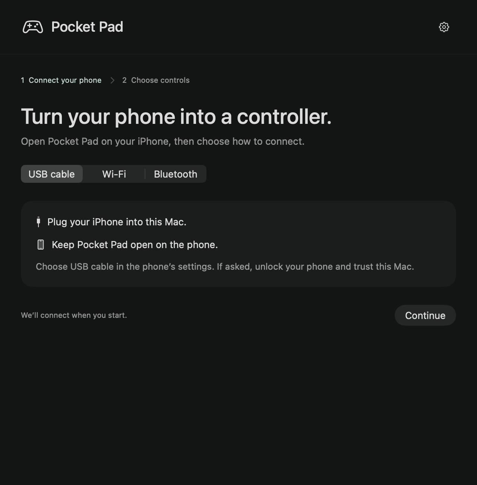

# PocketPad

**Turn your iPhone into a customizable controller for your Mac.** Free and open source under the MIT license, built with Swift, SwiftUI, and UIKit. No third-party package dependencies.

PocketPad is in release preparation. Keyboard/mouse and virtual gamepad output work in local testing; the Mac companion has passed Developer ID signing and notarization. Clean-install testing and broader game compatibility checks remain before public release.



## Features

- USB cable, local Wi-Fi, and Bluetooth transports. USB is the most exercised path; wireless needs broader device/network testing.
- Xbox and PlayStation touch-layout presets, named layouts, and independent Aim/Cursor modes.
- Move, resize, rename, and color controls; optional per-layout haptics.
- Optional linked positions across modes, copy-position, ghost outlines, and editor undo/redo.
- Analog sticks with optional floating centers, stick-tap actions, hold-to-aim attack buttons, and a cursor trackpad.
- Custom buttons and an eight-direction radial quick bar.
- Keyboard/mouse mappings with hold/tap behavior, combinations, scroll inputs, mouse sensitivity, and automatic running.
- App-scoped or global input, with release on stale connection/disconnect.
- Layout backups and portable JSON profiles that can bundle Mac mappings. Layout edits and selection sync between connected devices.

Controller layouts can select Xbox or PlayStation emulation. Recognition, prompts, and Steam Input requirements vary by game; public distribution signing is still being validated.

## Build and run

You need a Mac with Xcode, an iPhone, and your own Apple signing account. Deployment targets are macOS 15 and iOS 17; Xcode must support your actual devices.

1. Clone this repository and open `iPhoneGamepad.xcodeproj`.
2. Copy `Config/Local.xcconfig.example` to `Config/Local.xcconfig`, then set your team ID and unique bundle prefix. The local file is ignored by Git.
3. Run the **PhoneGamepad** scheme on your iPhone. Enable Developer Mode and trust your Mac/developer profile when prompted.
4. Run **MacGamepad** on your Mac.
5. Keep the phone app open. Choose USB cable on both devices, follow the Mac setup, select an app, and grant Accessibility permission for keyboard/mouse input.

Free signing works for local iPhone development but expires periodically. There is no prebuilt public release or TestFlight link yet.

See [setup and signing](docs/SETUP.md), [mappings and wireless connections](docs/KEYBOARD_MOUSE.md), and [validation status](docs/VALIDATION.md).

## Virtual gamepad status

The Mac backend uses `IOHIDUserDevice` and requires Apple's restricted `com.apple.developer.hid.virtual.device` entitlement in an authorized provisioning profile. Paid Developer Program membership alone does not grant it. This authorization is not bundled with the source code. See [authorization notes](docs/AUTHORIZATION.md).

## Development

```sh
swift test
swift run gamepad-host --monitor
```

The CLI also provides `--probe` and `--gamepad`; these require virtual-HID authorization. See [architecture](docs/ARCHITECTURE.md) for protocol details.

After adding Swift files, run `python3 Scripts/sync_project_sources.py`. Avoid rerunning the original project generator on a configured checkout; it replaces project settings.

## Release preparation

See [release readiness and product roadmap](docs/RELEASE_PLAN.md) for launch blockers, the guided setup redesign, Community Layouts, and the proposed AI layout assistant. AI and Marketplace currently have local preview interfaces; the online services are not implemented.

`Config/AppInfo.plist` supplies Bonjour declarations to the app Info.plists; it is not a privacy manifest. Required-reason API declarations are in `Config/PrivacyInfo.xcprivacy`. See the [submission packet](docs/SUBMISSION.md) for archive validation and outstanding release gates.

## Contributing

Bug reports, device compatibility reports, and pull requests are welcome. Include reproduction steps and OS versions. Do not commit signing certificates, provisioning profiles, pairing codes, personal layout exports, or device logs containing private information.

## License

[MIT](LICENSE). The native layered app icons use a clean vector controller symbol; source assets are included in `Assets/LayeredIcons/`. PocketPad is not affiliated with Apple, Microsoft, Sony, or the games used with it.
