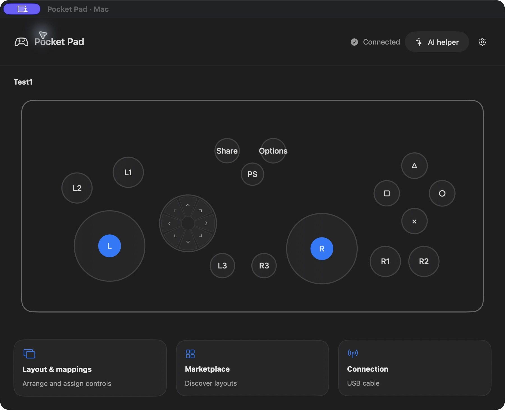
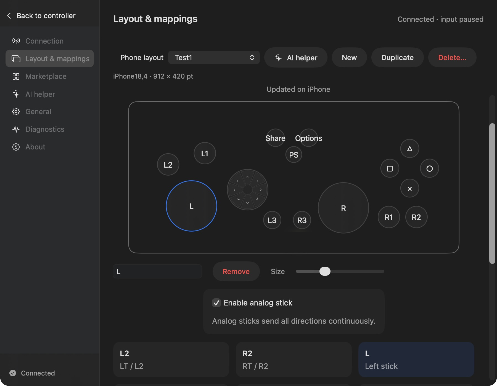

<div align="center">

# Gamepad Air

**Your iPhone. Your Mac controller. Your layout.**

Xbox · PlayStation · Keyboard & mouse<br>
USB · Wi-Fi · Bluetooth

**[Download for Mac](https://github.com/WilliamW9758/GamepadAir/releases/download/v1.0-beta.12/GamepadAir-1.0-build12.dmg)** · **[Join the iPhone beta](https://testflight.apple.com/join/BXcJ2RJU)**

[Report a bug](https://github.com/WilliamW9758/GamepadAir/issues) · [Roadmap](docs/RELEASE_PLAN.md)

</div>



### Make it yours

- **Play your way.** Xbox or PlayStation emulation, or keyboard/mouse mappings with recorded shortcuts, combos, and tap/hold actions.
- **Build your controller.** Arrange buttons, sticks, D-pads, radial menus, and rectangular trackpads on Mac or iPhone, with optional snapping and overlap feedback.
- **See every input.** The Mac mirrors your phone’s layout and live controls. Layout changes sync between devices.
- **Feel the feedback.** Adjustable button haptics and supported game rumble, with floating or fixed sticks.
- **Keep your favorites.** Save, duplicate, switch, share, and delete layouts. No account needed for local play.



### Start testing

Free public beta · **macOS 15+** · **iOS 17+**

1. **[Download the Mac app](https://github.com/WilliamW9758/GamepadAir/releases/download/v1.0-beta.12/GamepadAir-1.0-build12.dmg)**, open the DMG, and drag **Gamepad Air** to Applications. Signed and notarized by Apple.
2. **[Join the iPhone beta in TestFlight](https://testflight.apple.com/join/BXcJ2RJU)** and install Gamepad Air.
3. Open both apps, connect your iPhone with a USB data cable, and follow setup. Keep the iPhone app open while playing.

Use **build 12 on both devices**. No Xcode, Developer Mode, or account is needed for local play. Keyboard/mouse output needs Accessibility permission on Mac. Game compatibility and Steam Input settings vary.

[Release notes](https://github.com/WilliamW9758/GamepadAir/releases/tag/v1.0-beta.12) · [Report a bug](https://github.com/WilliamW9758/GamepadAir/issues)

### Community layouts

Browse and download layouts from the Mac Marketplace, or sign in with Apple to submit your own. AI-assisted creation is coming later and is currently disabled.

### For developers

Native Swift, SwiftUI, and UIKit. No third-party package dependencies.

[Build from source](docs/SETUP.md) · [Signing requirements](docs/AUTHORIZATION.md). Building virtual controller output requires Apple’s restricted virtual-HID entitlement.

```sh
swift test
swift run gamepad-host --monitor
```

[Architecture](docs/ARCHITECTURE.md) · [Layout format](docs/layout-format/README.md) · [AWS plan](docs/AWS_LAYOUT_SERVICE.md) · [Validation](docs/VALIDATION.md) · [Privacy](docs/PRIVACY.md)

---

[MIT licensed](LICENSE). Contributions and compatibility reports welcome. Gamepad Air is not affiliated with Apple, Microsoft, Sony, or the games used with it.
